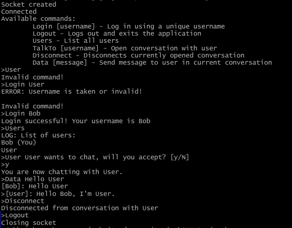
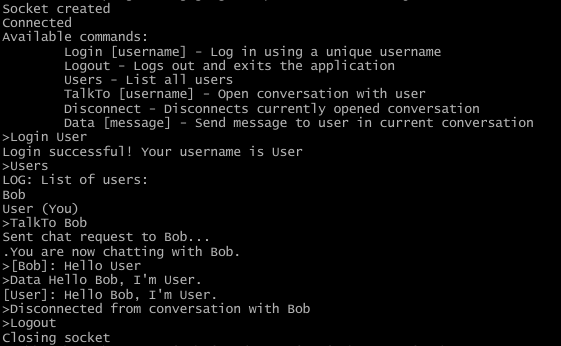
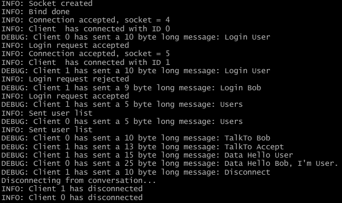

# ORM Project

This is a simple chatting application based on TCP, using a client-server model. Clients can set their own unique names and engage in 1-1 conversations. 







## Build instructions

Run the scripts ```build_server.sh``` and ```build_client.sh``` in the ```src``` directory.

## Usage

To run the server and client, in the ```src``` directory simply run: 
```
$ ./server

$ ./client
```

Optionally, the client application takes an additional argument for the server IP address. If not set, the client will attempt to connect to a server at ```localhost```.


